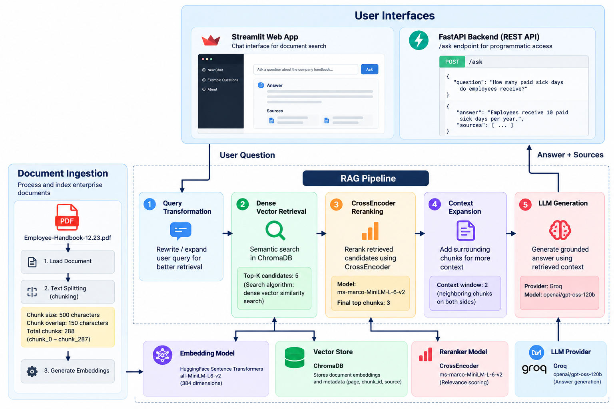
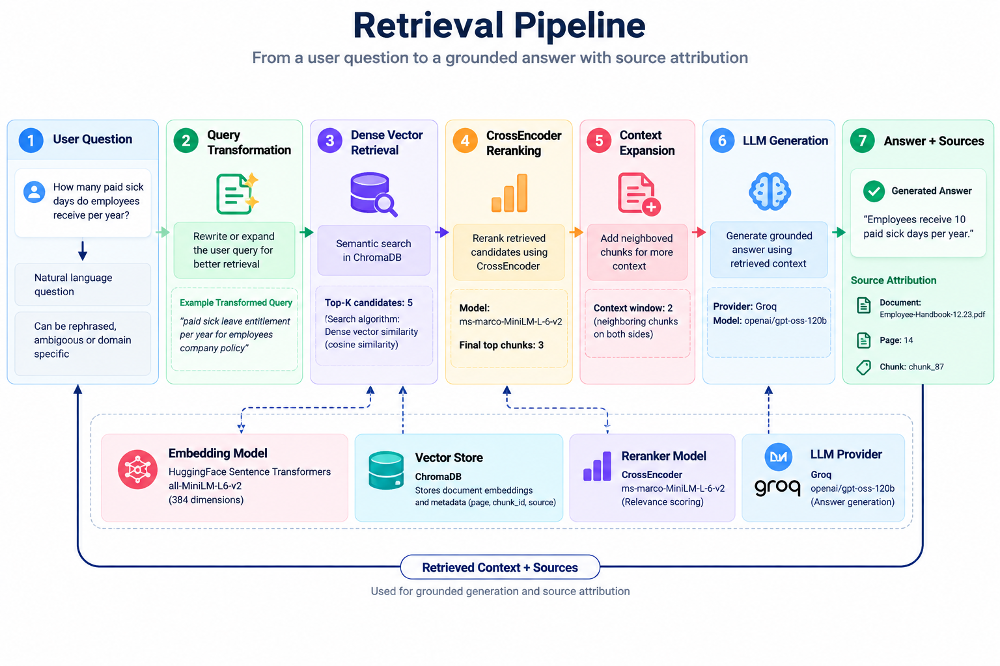
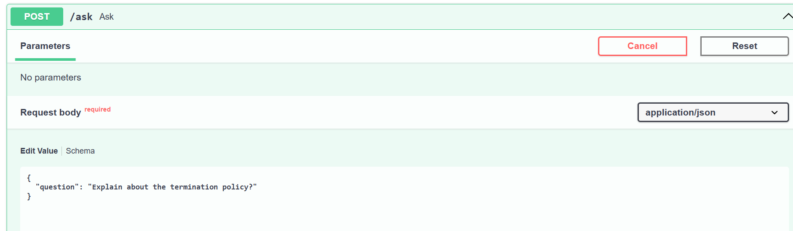
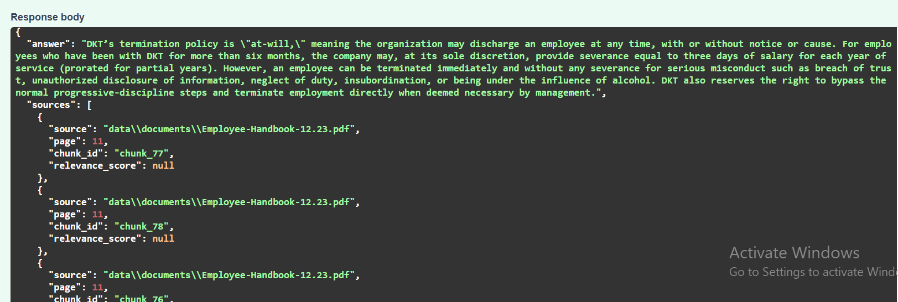
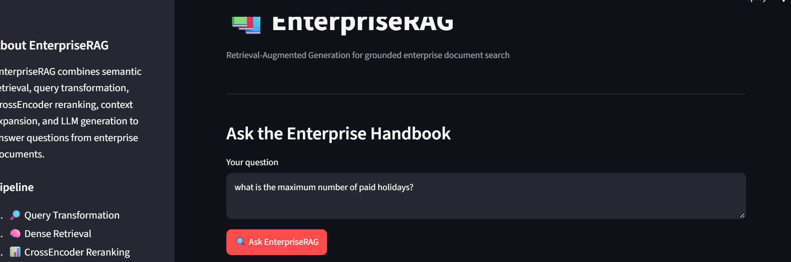
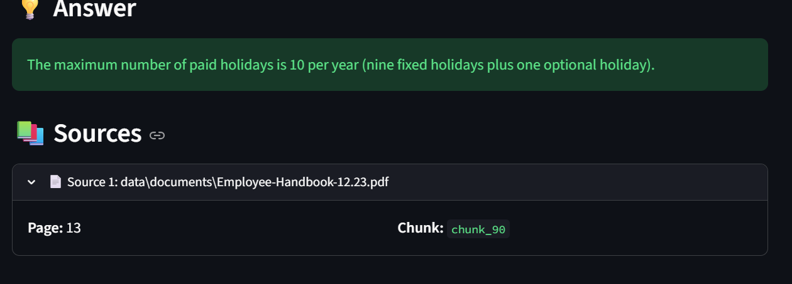

# EnterpriseRAG

**EnterpriseRAG** is a retrieval-augmented generation system for answering natural-language questions over enterprise documents.

The system is designed as a multi-stage RAG pipeline rather than a simple `vector database → LLM` implementation. It performs query transformation, dense vector retrieval, CrossEncoder reranking, context expansion, and grounded LLM generation, while exposing the system through both a FastAPI REST API and a Streamlit interface.

---

## 1. What This Project Does

EnterpriseRAG takes a question such as:

> "How many paid vacation days can employees carry over per year?"

and processes it through the following pipeline:

```text
User Question
     │
     ▼
Query Transformation
     │
     ▼
Dense Vector Retrieval
     │
     ▼
CrossEncoder Reranking
     │
     ▼
Context Expansion
     │
     ▼
Groq LLM
     │
     ▼
Grounded Answer + Sources
```

The current document collection is based on an enterprise employee handbook containing HR, payroll, leave, holiday, travel, and policy information.

---

# 2. System Architecture

```text
                         ┌───────────────────────┐
                         │   Enterprise Documents │
                         │        PDF / Text      │
                         └───────────┬───────────┘
                                     │
                                     ▼
                         ┌───────────────────────┐
                         │   Document Ingestion   │
                         │                        │
                         │ • Document loading     │
                         │ • Chunking             │
                         │ • Embeddings           │
                         └───────────┬───────────┘
                                     │
                                     ▼
                         ┌───────────────────────┐
                         │       ChromaDB        │
                         │     Vector Store      │
                         └───────────┬───────────┘
                                     │
                                     │
          ┌──────────────────────────┘
          │
          ▼
┌───────────────────────┐
│     User Question     │
└───────────┬───────────┘
            │
            ▼
┌───────────────────────┐
│ Query Transformation  │
└───────────┬───────────┘
            │
            ▼
┌───────────────────────┐
│ Dense Vector Search   │
│ Candidate K = 5       │
└───────────┬───────────┘
            │
            ▼
┌───────────────────────┐
│ CrossEncoder Reranker │
│ ms-marco-MiniLM-L-6-v2│
└───────────┬───────────┘
            │
            ▼
┌───────────────────────┐
│ Context Expansion     │
│ Window = 2            │
└───────────┬───────────┘
            │
            ▼
┌───────────────────────┐
│ Groq LLM              │
│ openai/gpt-oss-120b   │
└───────────┬───────────┘
            │
            ▼
┌───────────────────────┐
│ Answer + Evidence     │
│ + Source Metadata     │
└───────────────────────┘
```

---

# 3. Document Ingestion

The ingestion pipeline converts source documents into searchable chunks.

```text
Source Document
      │
      ▼
Document Loader
      │
      ▼
Text Splitting
      │
      ▼
Embedding Generation
      │
      ▼
ChromaDB
```

## Current Dataset

The current indexed document is:

```text
Employee-Handbook-12.23.pdf
```

The indexed document collection contains:

```text
288 chunks
chunk_0 → chunk_287
```

The chunk IDs are stored as metadata and are used later for source attribution and evidence tracking.

---

# 4. Chunking Strategy

EnterpriseRAG uses overlapping fixed-size text chunks.

### Configuration

| Parameter                |              Value |
| ------------------------ | -----------------: |
| Chunk size               | **500 characters** |
| Chunk overlap            | **150 characters** |
| Number of indexed chunks |            **288** |

The overlap is used to reduce information loss when a sentence, policy statement, or related piece of information crosses a chunk boundary.

Conceptually:

```text
Chunk 1
██████████████████████████████████████████████████
                         │
                         │ 150-character overlap
                         ▼
                  Chunk 2
                  ██████████████████████████████████████████████████
```

For example, the handbook's salary information spans multiple adjacent chunks. The evaluation data shows chunks `chunk_150`, `chunk_151`, `chunk_152`, and `chunk_153` covering the relevant payroll sections across pages 21–22.

---

# 5. Embedding Model

Each document chunk is converted into a dense vector representation using:

```text
sentence-transformers/all-MiniLM-L6-v2
```

The same embedding model is used by the retrieval layer and is also available to the RAGAS evaluation pipeline.

The resulting vectors are stored in:

```text
ChromaDB
```

---

# 6. Retrieval Algorithm

EnterpriseRAG uses **dense semantic vector similarity search** rather than keyword-only search.

The retrieval process is:

```text
Question
   │
   ▼
Transformed Query
   │
   ▼
Embedding
   │
   ▼
ChromaDB Vector Search
   │
   ▼
Top 5 Candidate Chunks
```

The current candidate retrieval configuration is:

```text
RETRIEVAL_K = 5
```

The purpose of this stage is **high-recall candidate generation**. The retrieved candidates are not immediately passed to the LLM.

They are sent to a second-stage reranker.

---

# 7. CrossEncoder Reranking

After vector retrieval, the five candidate chunks are reranked using a CrossEncoder:

```text
cross-encoder/ms-marco-MiniLM-L-6-v2
```

The reranking process evaluates the relationship between:

```text
Question ↔ Retrieved Chunk
```

rather than relying only on independent embedding similarity.

Pipeline:

```text
Top 5 Vector Candidates
          │
          ▼
      CrossEncoder
          │
          ▼
   Relevance Scores
          │
          ▼
    Top 3 Chunks
```

The current final retrieval stage uses:

```text
final_k = 3
```

This gives the generation stage a smaller set of higher-ranked candidates.

---

# 8. Context Expansion

The system then expands the reranked chunks with neighboring chunks.

Current configuration:

```text
Context window = 2
```

The purpose is to preserve surrounding information that may be necessary to interpret the retrieved chunk.

For example:

```text
Retrieved:
chunk_88

Expanded context:

chunk_86
chunk_87
chunk_88
chunk_89
chunk_90
```

This is particularly useful for policy documents where a rule may continue into the next chunk.

---

# 9. Query Transformation

Before retrieval, the original user question is passed through a query transformation stage.

The transformed query is then used for vector retrieval.

Conceptually:

```text
Original Question
       │
       ▼
Query Transformation
       │
       ▼
Retrieval Query
       │
       ▼
ChromaDB Search
```

This separates the wording used by the user from the wording optimized for document retrieval.

---

# 10. LLM Generation

The final context is passed to the Groq-hosted LLM.

Current model:

```text
openai/gpt-oss-120b
```

The generation pipeline receives:

```text
User Question
      +
Retrieved / Reranked Context
      +
Expanded Context
```

and generates the final answer.

The system is designed so that the answer is based on the retrieved evidence rather than unrestricted model knowledge.

---

# 11. Evidence and Source Attribution

Each response can include source metadata containing:

* Source document
* Page number
* Chunk ID
* Relevance score

Example:

```json
{
  "source": "Employee-Handbook-12.23.pdf",
  "page": 22,
  "chunk_id": "chunk_152",
  "relevance_score": 0.91
}
```

This allows the user to trace an answer back to the underlying document.

For example, the salary-deposit evaluation question retrieved page 22 chunks `chunk_152` and `chunk_153`, where the handbook states that employees can choose up to seven salary-deposit accounts.

---

# 12. Backend API

The backend is implemented using:

```text
FastAPI
```

The main endpoint is:

```text
POST /ask
```

### Request

```json
{
  "question": "How many bank accounts can employees use for salary deposits?"
}
```

### Response

The response contains the generated answer and source metadata.

Example structure:

```json
{
  "answer": "Employees can choose up to 7 bank accounts for salary deposits.",
  "sources": [
    {
      "source": "Employee-Handbook-12.23.pdf",
      "page": 22,
      "chunk_id": "chunk_152",
      "relevance_score": 0.91
    }
  ]
}
```

---

# 13. Streamlit Frontend

A Streamlit frontend provides a browser-based interface over the FastAPI RAG backend.

The user can:

1. Enter a question.
2. Submit the question.
3. Receive the generated answer.
4. Inspect the supporting source information.


---

# 15. Technology Stack

| Layer                | Technology                               |
| -------------------- | ---------------------------------------- |
| Programming Language | Python                                   |
| RAG Framework        | LangChain                                |
| Backend              | FastAPI                                  |
| Frontend             | Streamlit                                |
| Vector Database      | ChromaDB                                 |
| Embedding Model      | `sentence-transformers/all-MiniLM-L6-v2` |
| Retrieval            | Dense vector similarity search           |
| Reranker             | CrossEncoder                             |
| Reranker Model       | `cross-encoder/ms-marco-MiniLM-L-6-v2`   |
| LLM Provider         | Groq                                     |
| Generation Model     | `openai/gpt-oss-120b`                    |
| Evaluation           | RAGAS                                    |
| Evaluation Dataset   | 14 questions                             |

---

# 16. Project Structure

```text
enterprise-rag/
│
├── app/
│   ├── api/
│   │   ├── main.py
│   │   └── schemas.py
│   │
│   ├── ingestion/
│   │   ├── chunking.py
│   │   ├── loaders.py
│   │   ├── pipeline.py
│   │   └── storage.py
│   │
│   ├── models/
│   │   └── schemas.py
│   │
│   ├── rag/
│   │   ├── chains.py
│   │   ├── evidence.py
│   │   ├── llm.py
│   │   ├── prompts.py
│   │   └── test_rag.py
│   │
│   ├── retrieval/
│   │   ├── context_expansion.py
│   │   ├── embeddings.py
│   │   ├── query_transform.py
│   │   ├── reranker.py
│   │   ├── retriever.py
│   │   └── vectorstore.py
│   │
│   └── config.py
│
├── frontend/
│   └── streamlit_app.py
│
├── tests/
│   ├── evaluation_dataset.py
│   ├── evaluate_retrieval.py
│   ├── evaluate_answers.py
│   ├── evaluate_ragas.py
│   └── inspect_evidence.py
│
├── images/
│   ├── api.png
│   ├── api2.png
│   ├── streamlit-1.png
│   ├── streamlit-2.png
│   ├── architecture.png
│   └── pipeline.png
│
├── data/
├── chroma_db/
├── .env
├── .env.example
├── .gitignore
├── requirements.txt
└── README.md
```

---

# 17. Installation

## Clone

```bash
git clone <repository-url>
cd enterprise-rag
```

## Create Virtual Environment

### Windows

```powershell
python -m venv .venv
.venv\Scripts\activate
```

### macOS / Linux

```bash
python -m venv .venv
source .venv/bin/activate
```

## Install Dependencies

```bash
pip install -r requirements.txt
```

---

# 18. Environment Configuration

Create a `.env` file:

```env
GROQ_API_KEY=your_groq_api_key

LANGSMITH_API_KEY=your_langsmith_api_key
LANGSMITH_TRACING=false
LANGSMITH_PROJECT=enterprise-rag
```

Only the variables required by the enabled functionality need to be configured.

Do not commit `.env` or API keys to GitHub.

---

# 19. Running the Backend

Start FastAPI:

```powershell
uvicorn app.api.main:app --reload
```

API:

```text
http://127.0.0.1:8000
```

Swagger:

```text
http://127.0.0.1:8000/docs
```

---

# 20. Running the Frontend

In a second terminal:

```powershell
streamlit run frontend/streamlit_app.py
```

The terminal will display the local Streamlit URL.

---

# 21. Evaluation Methodology

The project uses a fixed evaluation dataset containing **14 questions** covering different sections of the enterprise handbook.

The evaluation was divided into two levels.

## Retrieval Evaluation

The expected source page for each question was known in advance.

The following metrics were measured:

### Hit@1

Whether the expected page appeared at rank 1.

### Hit@3

Whether the expected page appeared within the top three results.

### MRR

Mean Reciprocal Rank of the expected page.

### Retrieval Results

| Metric |    Result |
| ------ | --------: |
| Hit@1  |  **100%** |
| Hit@3  |  **100%** |
| MRR    | **1.000** |

All 14 questions retrieved the expected page at rank 1.

---

# 22. End-to-End RAG Evaluation

RAGAS was used to evaluate four standard RAG metrics:

| Metric            |      Score |
| ----------------- | ---------: |
| Faithfulness      | **0.8571** |
| Answer Relevancy  | **0.9120** |
| Context Precision | **0.7361** |
| Context Recall    | **0.8000** |

### Faithfulness — 0.8571

Measures whether the generated answer is supported by the retrieved context.

### Answer Relevancy — 0.9120

Measures whether the generated answer appropriately addresses the user's question.

### Context Precision — 0.7361

Measures how much of the retrieved context is relevant to the question.

### Context Recall — 0.8000

Measures how much of the information needed to answer the question was successfully retrieved.

These results were produced from the complete 14-question evaluation run.

---

# 23. Evaluation Questions

The test set covers:

```text
1. Maximum number of paid holidays
2. Vacation carry-over allowance
3. DKT Washington holiday schedule
4. Exempt vs. non-exempt classification
5. Employee payment schedule
6. HQ sick leave
7. International sick leave
8. New employee vacation allowance
9. Maximum vacation allowance
10. Paid jury duty
11. Initial international annual leave
12. Sick-day carry-over
13. International home leave
14. Salary deposit bank-account limit
```

The evaluation was deliberately designed to test different types of retrieval and generation behavior, including:

* Numerical answers
* Lists
* Policy explanations
* Employee-category distinctions
* Initial vs. maximum entitlements
* Multi-chunk answers
* Payroll information

---

# 24. Answer Generation Testing

The same 14-question dataset was also used to inspect generated answers against expected answers.

All 14 questions successfully produced an answer:

```text
14 / 14 = 100% successful generation
```

The inspection also identified cases where the answer was factually relevant but omitted secondary details. For example, the question about international annual leave exposed a distinction between the **initial 20-day entitlement** and the **later maximum of 25 days**.

This illustrates why retrieval evaluation alone is insufficient and why end-to-end answer evaluation is included.

---

# 25. Complete Request Flow

A request travels through the system as follows:

```text
                    USER
                     │
                     ▼
              ┌─────────────┐
              │  FastAPI /  │
              │  Streamlit │
              └──────┬──────┘
                     │
                     ▼
             User Question
                     │
                     ▼
          Query Transformation
                     │
                     ▼
             Query Embedding
                     │
                     ▼
               ChromaDB
             Dense Retrieval
                     │
                Top 5
                     │
                     ▼
             CrossEncoder
               Reranking
                     │
                Top 3
                     │
                     ▼
            Context Expansion
              Window = 2
                     │
                     ▼
              RAG Prompt
                     │
                     ▼
             Groq LLM
          gpt-oss-120b
                     │
                     ▼
          Structured Response
                     │
          ┌──────────┴──────────┐
          ▼                     ▼
       Answer                Sources
```

---

# 26. Why This Is More Than Basic RAG

A minimal RAG implementation often looks like:

```text
Question
   ↓
Embedding
   ↓
Vector Search
   ↓
LLM
```

EnterpriseRAG adds multiple retrieval and answer-quality stages:

```text
Question
   ↓
Query Transformation
   ↓
Dense Retrieval
   ↓
CrossEncoder Reranking
   ↓
Context Expansion
   ↓
Evidence-aware Generation
   ↓
Source Attribution
   ↓
Evaluation
```

This allows retrieval quality and generation quality to be evaluated separately.

---

# 27. Current Configuration

| Configuration            | Value                      |
| ------------------------ | -------------------------- |
| Chunk size               | 500                        |
| Chunk overlap            | 150                        |
| Indexed chunks           | 288                        |
| Candidate retrieval      | 5                          |
| Final reranked chunks    | 3                          |
| Context expansion window | 2                          |
| Embedding model          | `all-MiniLM-L6-v2`         |
| Reranker                 | `ms-marco-MiniLM-L-6-v2`   |
| Vector store             | ChromaDB                   |
| LLM                      | Groq `openai/gpt-oss-120b` |
| Evaluation questions     | 14                         |
| RAGAS metrics            | 4                          |

---

# 28. Limitations

The current implementation has several known limitations:

* Evaluation is based on a 14-question test set.
* The current dataset is centered on one enterprise handbook.
* Dense retrieval is used without a hybrid BM25 + vector retrieval layer.
* Context precision is lower than Hit@1, indicating that some retrieved context can still be unnecessary.
* Context recall is not perfect.
* LLM generation can occasionally confuse an initial entitlement with a later maximum entitlement when both appear in the retrieved context.
* Authentication and document-level authorization are not currently implemented.

---

# 29. Future Improvements

Potential improvements include:

* Hybrid BM25 + dense retrieval
* Metadata-aware filtering
* Adaptive retrieval depth
* Improved context selection
* Larger evaluation datasets
* Automated regression evaluation
* User authentication
* Document-level access control
* Multi-document collections
* Additional document formats
* Streaming generation
* Production monitoring and tracing
* CI/CD evaluation gates
---

---

## Screenshots

### Architecture

<table>
<tr>
<td align="center" width="50%">

</td>
</tr>
</table>

### Retrieval Pipeline

<table>
<tr>
<td align="center" width="50%">

</td>
</tr>
</table>

### API

<table>
<tr>
<td align="center" width="50%">

**Request**



</td>
<td align="center" width="50%">

**Response**



</td>
</tr>
</table>

### Streamlit

<table>
<tr>
<td align="center" width="50%">

**Request**



</td>
<td align="center" width="50%">

**Response**



</td>
</tr>
</table>

---

# 31. Author

**Arpan Neupane**

Computer Engineering | AI/ML | RAG Systems

GitHub:
https://github.com/arpanneupane75
